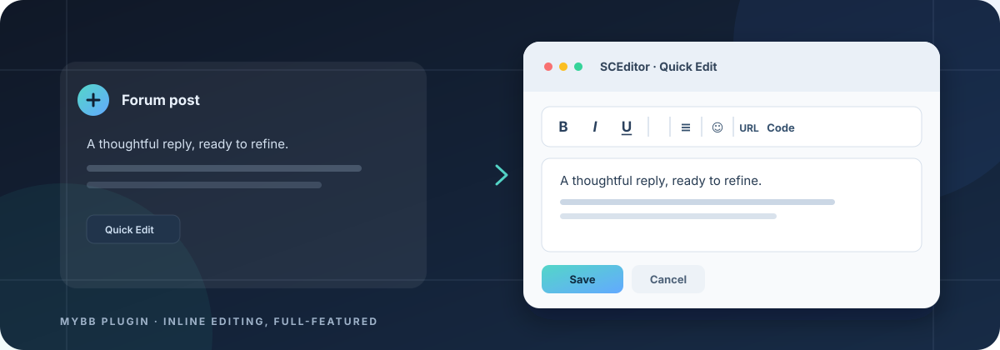

# Quick Edit Editor — MyBB Plugin

<p align="center"></p>

Adds MyBB's SCEditor to quick edit boxes on the showthread page. MyBB's inline quick edit is a plain textarea; this plugin replaces it with the same editor used by the full post editor, including toolbar, smilies, MyCode buttons, source mode, and maximise. Posts are fetched and saved through MyBB's existing quick-edit endpoints, so normal forum permissions and post handling continue to apply.

## Features

- **SCEditor in quick edit** — open a full editor in place of the post body.
- **Theme-aware assets** — reuses the current theme's live `codebuttons` template, falling back to the master template.
- **AJAX fetch and save** — uses MyBB's `xmlhttp.php?action=edit_post` endpoints and supports an optional edit reason.
- **Moderation-aware** — handles `moderation_post` / `moderation_thread` responses and follows the returned URL.
- **Post refresh** — updates the edited-by block and refreshes syntax highlighting when available.
- **Multiple editors** — tracks instances per post and restores the original `MyBBEditor` reference when quick edit closes.
- **Cancel support** — restores the original post content.
- **Public JavaScript API** — `window.QuickEditSCEditor` exposes editor lifecycle, configuration, and callback helpers.
- **Permission gates** — respects the master switch, `showcodebuttons`, allowed usergroups, and allowed forums.
- **Configurable** — editor height, MyCode toolbar, and smilies.

## Requirements

| Requirement | Version / note |
| --- | --- |
| MyBB | 1.8.x |
| PHP | 7.4+ (works on PHP 8.x) |
| SCEditor | Stock MyBB assets under `jscripts/sceditor/` |
| jQuery | Stock MyBB front-end jQuery |
| PluginLibrary | Not required |

## Installation

1. Extract the repository into your MyBB root (the directory containing `index.php`).
2. In **Admin CP → Configuration → Plugins**, install and activate **Quick Edit Editor**.
3. Go to **Configuration → Settings → Quick Edit Editor Settings** to configure height, MyCode/smilies, usergroups, and forums.
4. Open a thread and use **Quick Edit** on a post you are allowed to edit.

No template edits, core edits, database tables, or file permissions are needed. The plugin is hook-based.

## Settings

| Setting | Default | Description |
| --- | --- | --- |
| Enable Quick Edit Editor | `1` | Master switch. |
| Allow MyCode (BBCode) | `1` | Use the full MyCode toolbar; otherwise use a minimal toolbar. |
| Allow Smilies | `1` | Enable the emoticon button and smilie data. |
| Editor Height | `250` | Height in pixels; values below `100` fall back to `250`. |
| Allowed Usergroups | `2,3,4,6` | Primary and additional groups that load the editor. |
| Allowed Forums | `-1` (all) | Forums where the editor loads. |

## Repository layout

```text
inc/plugins/quickedit_editor.php                       # hooks, settings, config, header builder
inc/plugins/QuickEditEditor/functions.php              # helper functions
jscripts/quickedit_editor/quickedit_editor.js          # click handler, AJAX form, SCEditor init
inc/languages/english/quickedit_editor.lang.php        # language phrases
.github/quick-edit-cover.svg                           # README cover artwork
README.md
LICENSE                                                # GPL-3.0
```

The JavaScript file is deliberately outside `inc/plugins/` and must be uploaded to `jscripts/quickedit_editor/`.

## How it works

- The `showthread_end` hook checks plugin settings, `showcodebuttons`, usergroups, and forum restrictions.
- The plugin builds editor configuration and reuses the current theme's `codebuttons` template assets where available.
- A delegated click handler fetches the post, creates the editor form, and initializes SCEditor.
- Submit sends the message and edit reason to `xmlhttp.php`; the post body and edited-by block are refreshed on success.

## Notes and known limitations

- Re-activating the plugin can create duplicate settings; deactivate/reactivate behavior is not idempotent.
- The language file is not loaded, and the locale may be unavailable on showthread pages.
- If the `codebuttons` template cannot be found, the fallback header does not include SCEditor assets.
- MyBB's stock quick-edit handler and this plugin's handler both run, so their interaction can depend on handler order.
- Usergroup/forum filters treat empty values as allow-all; `-1` also means all.
- Saving continues through MyBB's normal handler, which enforces edit permissions, edit time limits, moderation, and the post key.

## Author

**PARAD0X** — [MyBB Community profile](https://community.mybb.com/user-134311.html)

- Website: https://mybb.epizy.com
- Version: 1.1.0

## License

GPL-3.0 — see [LICENSE](LICENSE).
